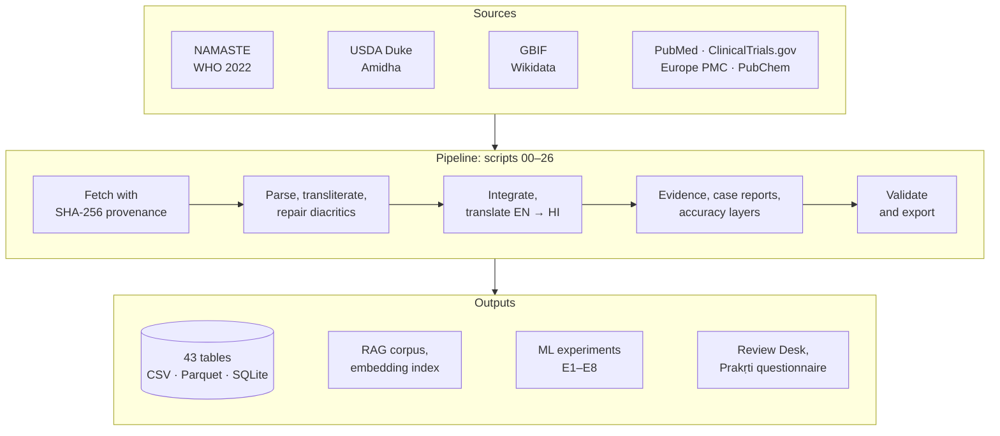

<div align="center">

# AyurKB

**A bilingual, hybrid Ayurveda knowledge base for clinical decision support and expert systems**

द्विभाषी आयुर्वेद ज्ञानकोश — निर्णय-सहायता एवं विशेषज्ञ प्रणालियों के लिए

[](docs/DATASHEET.md)
[](https://creativecommons.org/licenses/by-nc-sa/4.0/)
[](requirements.txt)
[](tests/)
[](release/datapackage.json)
[](#whats-inside)

[](#whats-inside)
[](#whats-inside)
[](#whats-inside)
[](#whats-inside)
[](#whats-inside)
[](#whats-inside)

[Quick start](#quick-start) · [What's inside](#whats-inside) · [Usage](#usage) · [Pipeline](#pipeline) · [Results](#results) · [Licence](#licence-and-attribution) · [Citation](#citation)

</div>

> [!IMPORTANT]
> **Decision-support data, not medical advice.** AyurKB is meant for research and for tools used by qualified
> practitioners. It gives no doses, and its curated layers are flagged for expert review.
> See [Limitations](#limitations-and-responsible-use).

## About

AyurKB links Ayurvedic **diagnosis, materia medica, remedies and modern scientific evidence** in one relational
dataset. Everything is in **English and Hindi**, and every Sanskrit term is given in **IAST and Devanagari**.

It is built only from authoritative or openly licensed sources: the Ministry of Ayush NAMASTE portal, WHO, USDA,
GBIF, Wikidata, NLM (PubMed, ClinicalTrials.gov, PubChem), Europe PMC and one DOI-registered CC BY herb database.
The data is cleaned and cross-validated, checked against 565 published case reports, and benchmarked with
18 machine-learning model configurations across experiments E1–E8.

### Highlights

- **Traceable sources.** Every file comes from an official download or API and is logged with a SHA-256 hash in
  `data/raw/PROVENANCE.json`. Every row carries its `source_id` and `licence`.
- **Bilingual by design.** English and Hindi throughout, Sanskrit in IAST and Devanagari, names in 8 regional
  scripts and 4,836 bilingual question–answer pairs.
- **Classical and modern side by side.** NAMASTE morbidity codes with 789 ICD-11 TM2 codes; Dravyaguṇa herb profiles
  next to USDA phytochemistry, PubChem identifiers, clinical trials and a PubMed evidence tier for every
  herb → disorder link.
- **Checked against real patients.** 565 published case reports serve as a real-world benchmark and as a curation
  queue of diagnosis–medicine pairs the knowledge base does not yet record.
- **Ready for expert systems.** A SQLite database, a Frictionless data package, a RAG corpus, a multilingual
  embedding index and a working bilingual demo, each built with one command.
- **Honest numbers.** Every model is compared with a baseline on the same folds, and negative results are reported.

## What's inside

43 tables in `data/processed/`, stored as CSV (the versioned source of truth). Parquet copies, the SQLite database
(`release/ayurkb.sqlite`) and the search corpus are rebuilt locally (see [Quick start](#quick-start)).
Every column is documented in [`docs/DATA_DICTIONARY.md`](docs/DATA_DICTIONARY.md).

| Area | Table | Rows | Highlights |
|---|---|---:|---|
| **Diagnosis** | `diseases` | 2,892 | NAMASTE morbidity codes, hierarchy, 789 WHO ICD-11 TM2 codes, 1,188 linked to WHO terms, doṣa labels |
| | `symptoms` | 11,081 | SAT-D lexicon (9,400 Sanskrit symptom phrases + English glosses) and 1,681 more from NAMASTE definitions |
| | `disease_symptom` | 11,884 | disease → symptom graph parsed from clinical definitions |
| | `diagnostic_methods` | 43 | trividha, ṣaḍvidha, aṣṭasthāna (nāḍī, mūtra, jihvā …), daśavidha, nidāna pañcaka, kriyākāla, plus modern and computational counterparts with PubMed evidence |
| **Herbs** | `herbs` | 466 | official Sanskrit names, GBIF-accepted botanical names, Hindi names, rasa / guṇa / vīrya / vipāka / karma / doṣa, safety class, PubMed & trial counts |
| | `herb_indication`, `herb_karma`, `herb_names` | 1,693 / 829 / 3.6k | herb → disease, herb → action, multilingual synonyms |
| | `herb_groups`, `herb_group_members` | 50 / 500 | Caraka's 50 mahākaṣāya |
| **Remedies** | `formulations` (+ ingredients, indications) | 43 | classical compound remedies with classical source, dosage form, doṣa action, safety (curated, flagged) |
| | `therapies` | 1,325 | pañcakarma, pūrvakarma, rasāyana, surgery & para-surgery, external therapies |
| | `therapy_disease` | 6,474 | disorder → procedure links from classical rules with text references, iatrogenic complications, procedures seen in case reports |
| | `pharmaceutics`, `diet_lifestyle` | 393 / 381 | dosage forms and processes; pathya, dinacaryā, ṛtucaryā |
| **Terminology** | `terminology` | 6,233 | WHO (3,554) + NAMASTE SAT (2,679) standard terms with WHO↔SAT cross-links |
| **Modern science** | `herb_phytochemicals`, `phytochemical_activities` | 23.8k / 13.5k | USDA Duke phytochemistry and bioactivities |
| | `herb_ethnobotany` | 2.9k | documented Indian ethnobotanical uses |
| | `clinical_trials` | 6.4k links (5.3k trials) | ClinicalTrials.gov studies per herb and formulation |
| **Real world** | `case_reports`, `case_report_entities` | 565 / 8,023 | published Ayurveda case reports (Europe PMC): NAMASTE diagnosis, presenting symptoms, herbs, formulations, procedures, modern tests; 115 adverse-event reports with implicated metals |
| | `case_report_links` | 867 | diagnosis × medicine pairs seen in practice, flagged when the KB lacks them (curation queue) |
| **Evidence** | `herb_indication_evidence`, `formulation_indication_evidence` | 1,427 / 121 | PubMed co-occurrence, clinical-study counts, lift over chance, top PMIDs and an evidence tier for every link |
| **Linked data** | `phytochemicals` | 1,959 | PubChem CID, InChIKey, formula, SMILES for key phytochemicals (1,732 matched) |
| | `herb_image_datasets` | 214 | links to 3 CC BY 4.0 leaf-image datasets for plant identification |
| **Language** | `multiscript_names`, `headword_concepts` | 20,895 / 3,347 | names in 8 regional scripts; Sanskrit headwords shared across WHO, SAT and NAMASTE |
| **Accuracy layers** | `disease_symptom_who`, `disease_symptom_inferred` | 13,639 / 10,082 | symptom profiles from WHO definitions' sign lists; inherited profiles for subtypes (flagged) |
| | `disease_symptom_from_cases` | 3,905 | symptom associations learned from published case reports (used by the expert system) |
| | `dosha_suggestions` | 1,420 | **model suggestions** for disorders whose doṣa is unspecified (confidence, second choice); to be confirmed by experts |
| | `curation/clinical_symptom_crosswalk.csv` | 183 | modern clinical expressions → SAT symptoms (auto-mapped, to review) |
| **AI-ready** | `qa_pairs` | 4,836 | bilingual Q&A generated from records (traceable ids) |
| | `prakriti_synthetic_cohort` | 3,000 | **synthetic** constitution questionnaire cohort (WHO-grounded) |
| | `release/ayurkb_corpus.jsonl`, `release/embeddings/` | 20k docs | RAG corpus and multilingual semantic index (built locally) |

**Coverage at a glance**

- **Remedies:** herb indications, mahākaṣāya groups, 43 classical formulations, therapies, diet and lifestyle.
- **Herbs:** 466 with full Dravyaguṇa profiles.
- **Diagnosing techniques:** classical examination methods with their references.
- **Old and modern methods:** classical texts and standards alongside phytochemistry, clinical trials, ICD-11 coding
  and computational diagnostics.
- **Hybrid:** authoritative, community and linked open data; tabular, text, graph and numeric records; real and
  clearly labelled synthetic or derived rows.
- **Bilingual:** English and Hindi, with Sanskrit in IAST and Devanagari.

## Quick start

The tables are plain CSV, so reading them needs only pandas. To run the tests, the demo or the pipeline, install the
pinned requirements:

```bash
git clone https://github.com/IAbdullahSlash/Ayurveda-dataset.git
cd Ayurveda-dataset
python3 -m venv .venv && source .venv/bin/activate
pip install -r requirements.txt
```

Run the checks (about 10 seconds). On a fresh clone the release-zip check is skipped until the zip is built with
`bash scripts/13_package.sh`:

```bash
python3 -m pytest -q tests/
```

Build the SQLite database, the RAG corpus and the data package (about 10 seconds):

```bash
python3 -I scripts/08_validate_export.py
```

Try the expert-system demo. `--no-semantic` uses lexical matching only, so no model download is needed:

```bash
python3 examples/expert_system_demo.py --no-semantic \
    --symptoms "fever; burning sensation; excessive thirst; vomiting"
```

<details>
<summary><b>Semantic search and full rebuild</b></summary>
<br>

Download the two third-party models once (about 2.9 GB; pinned revisions, safetensors weights only), then build the
multilingual embedding index (about 10–15 minutes on CPU):

```bash
python3 -I scripts/00_get_models.py
python3 -I scripts/11_embed_index.py --part all
```

Rebuild everything from the sources. This takes about 2 hours on 4 CPUs, mostly translation and API calls; responses
are cached, so re-runs are fast. The WHO PDF parser also needs `poppler-utils` (`pdftotext`).

```bash
bash run_all.sh
```

</details>

## Usage

**pandas**: pitta disorders with their Sanskrit, Hindi and ICD-11 names

```python
import pandas as pd
d = pd.read_csv("data/processed/diseases.csv", keep_default_na=False)
cols = ["namc_code_clean", "term_iast", "term_deva", "name_en", "name_en_hi", "icd11_tm2_code"]
d[d.dosha_label == "pitta"][cols]
```

**SQL** (`release/ayurkb.sqlite`): herbs indicated for any kind of kāsa (cough), with safety flags

```sql
SELECT h.name_sa_iast, h.accepted_name, h.name_hi_common, h.virya, h.safety_class
FROM herb_indication i JOIN herbs h USING(herb_id) JOIN diseases d USING(disease_id)
WHERE d.term_iast LIKE '%kās%';
```

**Literature evidence** for each herb recorded for prameha

```sql
SELECT h.name_sa_iast, h.accepted_name, e.evidence_tier, e.n_pair, e.n_clinical, e.clinical_pmids
FROM herb_indication_evidence e JOIN herbs h USING(herb_id) JOIN diseases d USING(disease_id)
WHERE d.term_iast = 'pramehaḥ' ORDER BY e.n_clinical DESC;
```

**Expert-system demo**: symptoms in English or Hindi → candidate disorders → herbs (sorted by evidence),
formulations, classical procedures and what practitioners used in published cases. It combines lexical and
multilingual semantic matching when the models are present; see
[`docs/EXPERT_SYSTEM_GUIDE.md`](docs/EXPERT_SYSTEM_GUIDE.md).

```bash
python3 examples/expert_system_demo.py --symptoms "fever; burning sensation; excessive thirst; vomiting"
python3 examples/expert_system_demo.py --symptoms "बुखार; जलन; अधिक प्यास" --lang hi
```

### Tools for experts and studies

| Tool | What it is for |
|---|---|
| **Review Desk** (`release/tools/review_desk.html`) | Invited vaidyas give a verdict on each herb → disorder and procedure → disorder link. Verdicts are stored per anonymous reviewer; the owner sees agreement (Fleiss' κ) and exports CSV. |
| **Prakṛti questionnaire** (`release/tools/prakriti_questionnaire.html`) | Bilingual, with a consent screen, classical scoring (the E4 rule) and optional anonymous saving by the study team (interviewer mode). |
| **Offline review workbook** (`review/AyurKB_expert_review.xlsx`) | Drop-down verdicts per sheet. Return completed copies to `review/returned/` and run `python3 scripts/21_review_workbooks.py --merge`. |
| **Permission letters** (`docs/permission_requests/`) | Ready-to-send requests to PCIM&H (API/AFI), Ministry of Ayush (NAMASTE licence), WHO, the IMPPAT team and CCRAS. |

## Pipeline



| Phase | Script | What it does |
|---|---|---|
| Setup | `00_get_models.py` | downloads NLLB-200 and multilingual-e5 at pinned revisions (safetensors only) |
| Fetch | `01_fetch_sources.py` | downloads every source through its official download or API; SHA-256 provenance manifest |
| Pre-process | `02a_parse_who.py` | WHO PDF → table by word coordinates; validated against the book's own index (99.85% of IDs) |
| | `02b_parse_namaste.py` | NAMASTE phonetic → IAST → Devanagari; repairs lost diacritics (vocabulary + character 4-gram LM, 90% of damaged tokens) |
| | `02c_parse_herbs.py` | SAT-F plant list, mahākaṣāya, karma; Amidha herbs; USDA Duke tables |
| | `03_enrich_taxonomy.py` | GBIF validation (97% of names resolved, synonyms updated, ambiguity left unresolved); Wikidata Hindi names |
| Integrate | `04_build_kb.py` | integration, hierarchy, ICD-11 TM2, doṣa labels, symptom graph, herb master, safety, curated layers |
| | `05_evidence.py` | PubMed and ClinicalTrials.gov evidence |
| | `06_translate.py` | English → Hindi with NLLB-200: glossary injection, Sanskrit protection, quality estimation |
| Real world | `14_case_reports.py` | Europe PMC case reports → diagnosis, symptoms, herbs, formulations, procedures, modern tests, adverse events (E6) |
| | `15_link_evidence.py` | PubMed evidence tier for every herb / formulation → disorder link |
| | `16_links_scripts_concepts.py` | disorder → procedure rules, 8 regional scripts, cross-source headword concepts |
| | `17_phytochem_ids.py` | PubChem identifiers (+ ChEMBL targets, kept in a separate CC BY-SA file) |
| | `18_image_datasets.py` | links to CC BY 4.0 plant-image datasets |
| | `19_ictrp_import.py` | optional: import a manual WHO ICTRP / CTRI export (drops personal data) |
| | `25_fill_missing.py` | WHO definitions and sign lists, inherited profiles, doṣa suggestions, Hindi post-edits (all flagged) |
| Machine learning | `07_ml.py`, `10_crosslingual.py` | experiments E1–E5 |
| | `20_tuning.py` | E7: nested-CV hyperparameter tuning |
| | `23_finetune_search.py` | E5b: domain fine-tuning of the multilingual search model, test concepts held out (~40 min CPU) |
| | `24_improve_matching.py` | E6b: clinical-term crosswalk, semantic matching, group ranking, case-learned profiles |
| | `26_model_upgrades.py` | E2c+ and E1+: chemistry features and multilingual embeddings compared with the originals |
| Export | `08_validate_export.py` | integrity checks, bilingual Q&A, RAG corpus, SQLite, Frictionless `datapackage.json` |
| | `09_docs.py`, `11_embed_index.py` | data dictionary; multilingual embedding index |
| | `12_report.py`, `13_package.sh` | dataset report and the result tables in this README; release zip |
| | `21_review_workbooks.py`, `22_build_tools.py` | expert-review workbook (build / merge) and the interactive tools |
| Test | `tests/` | 90 automated checks: transliteration, keys, references, encoding, domain and safety rules, bilingual coverage, ML baselines, the demo |

**Built with**

[](https://pandas.pydata.org/)
[](https://scikit-learn.org/)
[](https://pytorch.org/)
[](https://huggingface.co/docs/transformers)
[](https://lightgbm.readthedocs.io/)
[](https://xgboost.readthedocs.io/)
[](https://sqlite.org/)

## Results

Every number below comes from `reports/ml/` (one JSON/CSV per experiment) and is regenerated by
`scripts/12_report.py`. Figures are in [`reports/figures/`](reports/figures/), and the full dataset report is
`release/report.html` (open it in a browser).

### Machine-learning benchmarks (E1–E4)

<!-- ML_TABLE_START -->
| Exp. | Task | Data | Best model | Score | Reference point |
|---|---|---|---|---|---|
| E1a | Disorder → organ system from clinical text | real · NAMASTE | Logistic Regression | macro-F1 0.801 | Dummy (majority) 0.034 |
| E1b | Doṣa involvement from symptom text (doṣa words masked) | real · NAMASTE | Logistic Regression | macro-F1 0.738 | Dummy (majority) 0.145 |
| E1c | Same task in English vs Hindi text | real · NAMASTE | Logistic Regression · English | macro-F1 0.801 | Dummy (majority) · English 0.034; Dummy (majority) · Hindi (MT) 0.034 |
| E2a | Herb vīrya (uṣṇa / śīta) from rasa, guṇa, vipāka, karma | real · herbs | Extra Trees | macro-F1 0.797 | rule: rasa majority (hot vs cold tastes) 0.760; rule: vipāka (madhura -> śīta) 0.635 |
| E2b | Doṣa-pacifying profile (V / P / K, mean of three labels) | real · herbs | SVM (RBF) | macro-F1 0.857 | Classical rule (Ayurvedic theory) 0.743; Dummy (majority) 0.376 |
| E2c | Herb indications from rasa / guṇa / vīrya / vipāka / doṣa | real · herbs | LightGBM | macro-F1 0.604 | Dummy (majority) 0.453 |
| E3a | Symptom set → disorder (60 disorders) | hybrid · simulated cases | MLP (neural net) | top-1 accuracy 0.928 | Knowledge-base matcher (IDF-cosine, no training) 0.967; Dummy (majority) 0.017 |
| E3b | Symptom set → disorder (all distinguishable disorders) | hybrid · simulated cases | Naive Bayes | top-1 accuracy 0.882 | Knowledge-base matcher (IDF-cosine, no training) 0.893 |
| E4 | Prakṛti (7 constitution types) from questionnaire | synthetic · WHO-grounded | Naive Bayes | macro-F1 0.653 | Classical questionnaire scoring (count V/P/K answers) 0.618; Dummy (majority) 0.053 |
<!-- ML_TABLE_END -->

### Real-world validation and evidence (E6, E7)

**E6, real case reports.** On 85 published cases with a NAMASTE diagnosis and two or more presenting symptoms, the
no-training KB matcher ranks the diagnosed disorder family in its top 10 for 20% of cases (top 30: 32%), against 9%
for a popularity baseline and 0.6% by chance among 1,595 disorders. The upgrades in E8 raise the top-10 rate to 48%.
Case reports describe patients in modern clinical language, which the classical symptom lexicon only partly covers.
Only 13% of the diagnosis–herb pairs seen in practice are recorded in the KB, so `case_report_links` doubles as a
curation queue.

**E7, tuning.** Nested cross-validation changes macro-F1 by −0.02 to +0.10. Tuning helped models with poorly suited
defaults (Complement NB on text, Random Forest on the questionnaire) and slightly hurt on the 344-herb dataset, where
the inner search overfits.

**Link evidence.** Of 1,427 herb → disorder links, 204 have at least one clinical study in PubMed, 241 have supporting
literature, 431 are sparse and 518 have none (classical use only).

### Accuracy upgrades (E8)

Measured on the same rows and folds as the original experiments:

<!-- UPGRADES_START -->
| Area | Before | After | What changed |
|---|---|---|---|
| Real cases: right disorder group in top 10 | 20% | 48% (±4%) | clinical-term crosswalk, meaning-based matching, group ranking, profiles learned from real cases (5-fold CV) |
| Real cases: right group ranked first | 2% | 17% | same |
| Adding WHO sign lists to the matcher (top 10) | 28% | 11% | made it worse: the lists are broad, so they are kept for explanation and left out of ranking |
| Real cases, top 10, with the fine-tuned search model | 48% | 47% | no gain on English case text (within ±4% noise); the fine-tuned model is used for Hindi search, where it helps |
| Search disorders by Sanskrit headword (recall@10) | 0.24 | 0.56 | search model fine-tuned on the dataset's own pairs, test concepts held out |
| Search symptoms by Sanskrit headword (recall@10) | 0.20 | 0.45 | search model fine-tuned on the dataset's own pairs, test concepts held out |
| Organ system from text (E1a), macro-F1 | 0.801 | 0.837 | TF-IDF + e5 + LR |
| Doṣa from symptom text (E1b), macro-F1 | 0.738 | 0.750 | TF-IDF + e5 + LR |
| Same task in Hindi (E1c), macro-F1 | 0.724 | 0.802 | TF-IDF + e5 + LR |
| Herb indications (E2c), macro-F1 | 0.604 | 0.603 | + chemistry + family: no meaningful gain - phytochemistry does not predict classical indications here |
| Disorders with a definition | 55.5% | 69.8% | 415 WHO definitions for disorders NAMASTE leaves undefined |
| Disorders with a symptom profile | 1,595 | 2,243 | 13,639 edges from WHO sign lists + inherited profiles for subtypes (flagged) |
| Disorders with a doṣa suggestion | 0 | 1,420 | text model, cross-validated accuracy 0.90; flagged for expert review |
| Hindi translation errors fixed by rule | - | 35 rows | e.g. 'stiffness' had been translated as 'bitterness' |
<!-- UPGRADES_END -->

## Repository layout

```text
Ayurveda-dataset/
├── data/
│   ├── raw/            source files as downloaded, with PROVENANCE.json (SHA-256)
│   ├── interim/        parsed intermediates; cached API responses and translations
│   └── processed/      the knowledge base: 43 CSV tables
├── curation/           curated layers: formulations, safety, glossary, crosswalks (flagged for review)
├── scripts/            pipeline stages 00–26 and shared helpers (lib/)
├── tests/              automated checks
├── examples/           expert-system demo
├── models/trained/     small trained classifiers (E3, E4)
├── reports/            build reports, ML results (ml/) and figures
├── release/            datapackage.json, dataset report, interactive tools
├── review/             offline expert-review workbook
├── docs/               datasheet, sources, data dictionary, expert-system guide, permission letters
├── run_all.sh          rebuilds everything end to end
├── requirements.txt    pinned dependencies
└── CITATION.cff        citation metadata
```

## Status and roadmap

Release **v1.2**. Done:

- [x] 26 pipeline stages, experiments E1–E8 and 90 automated checks
- [x] Dataset report, Review Desk and Prakṛti questionnaire (source pages in `release/tools/`)
- [x] ChEMBL compound–target links: 323 links, 62 compounds, 196 human proteins (built locally, see below)

Next:

- [ ] **Expert review.** Collect verdicts with the Review Desk or `review/AyurKB_expert_review.xlsx`, then run
  `python3 scripts/21_review_workbooks.py --merge`. Start with the "possible name-mapping error", "model unsure" and
  "seen in case reports" items.
- [ ] **Permissions.** Send the letters in `docs/permission_requests/`.
- [ ] **Ethics approval** before collecting Prakṛti questionnaire responses.
- [ ] **Hindi review.** Have a Hindi speaker correct the flagged translations (sheet `hindi_translations`).
- [ ] **Optional:** import a WHO ICTRP / CTRI export with `scripts/19_ictrp_import.py`.

### Not in git (rebuilt locally)

| Item | Rebuild with |
|---|---|
| Model weights: NLLB-200, multilingual-e5 (~2.9 GB) | `python3 -I scripts/00_get_models.py` |
| Fine-tuned search model | `python3 -I scripts/23_finetune_search.py` |
| SQLite database, RAG corpus | `python3 -I scripts/08_validate_export.py` |
| Embedding index | `python3 -I scripts/11_embed_index.py --part all` |
| ChEMBL targets (CC BY-SA 3.0, share-alike) | `python3 -I scripts/17_phytochem_ids.py --chembl-only` |
| Release zip | `bash scripts/13_package.sh` |
| Europe PMC article texts (never redistributed) | re-downloaded by `scripts/14_case_reports.py` |

Cached API responses and translations are versioned in `data/interim/cache/`, so a re-run needs no new translation
and few network calls.

## Limitations and responsible use

- Not for autonomous diagnosis or prescribing; no doses are given.
- Curated layers (`curation/`: formulations, diagnostic correspondences, safety list, glossary, questionnaire,
  taxonomy overrides) need review by a qualified Ayurveda expert. Formulations should be checked against the
  Ayurvedic Formulary of India.
- Hindi descriptions are machine-translated. They are labelled with `*_method` and `*_qe_flags`; quality estimates
  are in `reports/translation_qe.json`.
- The Prakṛti cohort is synthetic. E4 metrics show how well models recover the generating model, not clinical
  accuracy. E3 uses simulated presentations built from the real disease–symptom graph.
- Herb properties come from one community source (344 herbs) and reflect one reading of the classical texts.
- Case-report entities are text-mined with the KB lexicons (precision over recall). Literature tiers are PubMed
  co-occurrence counts: a pointer to evidence, not proof of efficacy.
- Procedure links are rule-based from classical references; generic doṣa-principle links (`strength = generic`) need
  patient-level judgement (strength, age, season, contraindications).

## Contributing

The most valuable contribution is **expert review** by qualified Ayurveda practitioners, through the Review Desk or
the review workbook. Corrections to name mappings, formulations and Hindi translations are welcome as issues or pull
requests. Make data changes in the pipeline or in `curation/` rather than by hand in `data/processed/`, and run
`python3 -m pytest -q tests/` before opening a pull request.

## Licence and attribution

The combined release is licensed **[CC BY-NC-SA 4.0](https://creativecommons.org/licenses/by-nc-sa/4.0/)**, as
required by the WHO component (CC BY-NC-SA 3.0 IGO) and the NLLB-200 licence. Each row carries `source_id` and
`licence`, so a commercial-safe subset can be cut.

| ID | Source | Licence |
|---|---|---|
| S0 | Curated layers of this project | CC BY 4.0 |
| S1–S2 | NAMASTE: National Ayurveda Morbidity Codes and Standardised Ayurveda Terminologies, Ministry of Ayush, Govt. of India | public standard, attribution; no explicit open licence (see `docs/permission_requests/`) |
| S3 | WHO international standard terminologies on Ayurveda (2022) | CC BY-NC-SA 3.0 IGO |
| S4 | USDA-ARS Dr. Duke's Phytochemical and Ethnobotanical Databases | CC0 1.0 |
| S5 | Amidha Ayurveda Herb Database v2.0, S. Varshney ([10.5281/zenodo.20581467](https://doi.org/10.5281/zenodo.20581467)) | CC BY 4.0 |
| S6 | Wikidata | CC0 1.0 |
| S7 | GBIF Backbone Taxonomy | CC BY 4.0 |
| S8 | PubMed (NCBI E-utilities) | public domain (US Government) |
| S9 | ClinicalTrials.gov | public domain (US Government) |
| S10 | Europe PMC case reports | bibliographic metadata and extracted identifiers only; article texts not redistributed |
| S11 | PubChem | public domain (US Government) |
| S12 | MED117, Medicinal Leaf and Indian Medicinal Leaves image datasets (Mendeley Data) | CC BY 4.0 |
| S13 | WHO ICTRP, optional manual export | WHO ICTRP terms (non-commercial, attribution) |

ChEMBL-derived targets are distributed separately under CC BY-SA 3.0. The NLLB-200 translation model is
CC BY-NC 4.0 and multilingual-e5 is MIT. More detail: [`docs/SOURCES.md`](docs/SOURCES.md),
[`docs/DATASHEET.md`](docs/DATASHEET.md), [`docs/EXPERT_SYSTEM_GUIDE.md`](docs/EXPERT_SYSTEM_GUIDE.md).

## Citation

If you use AyurKB, please cite it together with the original sources above. GitHub's **Cite this repository**
button reads [`CITATION.cff`](CITATION.cff).

```bibtex
@misc{azmi2026ayurkb,
  author       = {Azmi, Abdullah},
  title        = {{AyurKB}: A Bilingual, Hybrid Ayurveda Knowledge Base for Expert Systems},
  year         = {2026},
  note         = {Version 1.2. Dataset licensed CC BY-NC-SA 4.0},
  howpublished = {\url{https://github.com/IAbdullahSlash/Ayurveda-dataset}}
}
```
