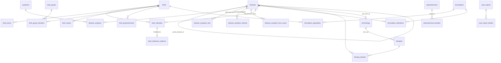

# Architecture

How AyurKB is put together: the data model, the conventions every table follows, what each pipeline stage reads
and writes, and which stages to re-run after a change. For what the dataset contains and why, read the
[README](../README.md) and the [datasheet](DATASHEET.md) first. Column-level detail is in the
[data dictionary](DATA_DICTIONARY.md).

## 1. Big picture

```text
data/raw/        sources exactly as downloaded (+ PROVENANCE.json with SHA-256)
   │  02a/02b/02c parse · 03 taxonomy
   ▼
data/interim/    parsed intermediates + cache/ (API responses, translations)
   │  04 integrate (+ curation/) · 05 evidence · 06 translate · 14–18 extension layers · 25 accuracy layers
   ▼
data/processed/  43 CSV tables = the knowledge base (source of truth, versioned)
   │  08 export · 09 docs · 11 index · 12 report · 21/22 review tools · 07/10/20/23/24/26 experiments
   ▼
release/, reports/, review/, docs/DATA_DICTIONARY.md, README tables
```

Three rules hold everywhere:

1. **The CSVs in `data/processed/` are the source of truth.** Parquet copies, SQLite, the RAG corpus and the
   embedding index are derived and not versioned.
2. **Nothing in `data/processed/` is edited by hand.** Every value comes from a source file, a cached API
   response, a file in `curation/` or a script. A fix is made where the value comes from, then the stage is re-run.
3. **Nothing is silently invented.** Model output, inferred links and curated text are kept in clearly flagged
   tables or columns (`data_origin`, `*_method`, `status`), never merged into authoritative columns.

## 2. Data model

### Core entities and links



| Entity | Key | Example | Notes |
|---|---|---|---|
| disorder | `diseases.disease_id` | `AYD-00763` | one row per NAMASTE code; tree via `parent_disease_id` (depth 0–6); `namc_code_clean`, `icd11_tm2_code`, `who_term_id` link to the standards |
| symptom | `symptoms.symptom_id` | `SYM-01538`, `SYM-N00394` | `SYM-0…` = SAT-D lexicon entries; `SYM-N…` = phrases found only in NAMASTE definitions (no SAT code, often no Sanskrit) |
| standard term | `terminology.term_uid` | `WHO:ITA-5.43.4`, `SAT:SAT-A.1` | WHO 2022 and SAT terms; `therapies`, `pharmaceutics`, `diet_lifestyle` are subsets that keep `term_uid` |
| herb | `herbs.herb_id` | `HERB-0132` | one row per GBIF-accepted species (`accepted_name`, `gbif_key`) |
| formulation | `formulations.form_id` | `FORM-001` | 43 curated classical formulations |
| diagnostic method | `diagnostic_methods.dx_id` | `DX-001` | curated |
| mahākaṣāya group | `herb_groups.group_id` | `SAT-F.188` | Caraka's 50 groups of 10 herbs |
| phytochemical | `phytochemicals.chemical` | `QUERCETIN` | Duke chemical name; PubChem CID / InChIKey when matched |
| case report | `case_reports.case_id` | `CASE-PMC13683760` | identifiers and extracted entities only, never article text |
| source | `sources.source_id` | `S0`–`S13` | every row of every table points here |

Link tables use plain id columns (`disease_id`, `symptom_id`, `herb_id`, …); several ids in one cell are separated
by `;` (or `; ` in a few text-heavy columns). Referential integrity is enforced by `tests/test_ayurkb.py`.

### How the disorder → symptom graph is built

`disease_symptom` is parsed from NAMASTE clinical definitions (stage 04). Each mention keeps its order
(`mention_rank`), its Sanskrit (`mention_sa_iast`) and English (`mention_en`), and how it was linked
(`link_method`: `sanskrit_headword`, `english_gloss` or `new_from_namaste`, which created a `SYM-N…` entry).
Stage 25 adds three separate, flagged layers rather than mixing them in: WHO sign lists, profiles inherited from
the nearest ancestor, and associations learned from published cases. The demo ranks only on `disease_symptom` plus
case-learned profiles (WHO lists lowered real-case accuracy, see E6b).

### Column conventions

| Column (pattern) | Meaning |
|---|---|
| `source_id`, `licence` | provenance of the row; allows cutting a licence-specific subset |
| `data_origin` | `authoritative`, `integrated`, `curated_requires_expert_verification`, `derived (…)`, `inferred: … (flagged)`, `synthetic`, … |
| `*_sa_iast`, `term_iast` | Sanskrit in IAST (NFC). ISO-15919 input (ō, ē, r̥) is normalised to IAST |
| `*_deva`, `*_sa_deva` | Sanskrit in Devanagari (official form kept when it agrees with the derived one) |
| `term_hi`, `*_hi_usage` | Hindi usage form of the Sanskrit (rule-based: visarga/virāma dropped, anusvāra normalised) |
| `*_ascii`, `*_phonetic` | ASCII folds / NAMASTE's phonetic input, used for joining loosely spelled sources |
| `<field>_hi` | Hindi for an English field |
| `<field>_hi_method` | how that Hindi was made, e.g. `nllb200_600m_glossary_injected`, `composed: …`, `… (WHO term)`, `… + post-edited (mt_postedit_rules)` |
| `<field>_hi_qe_flags` | automatic quality warnings: `terms_lost`, `repetition`, `length_ratio`, `low_devanagari` (`component_…` / `explanation_…` in composed definitions) |
| `status` | in model-suggestion tables: always "model suggestion - not authoritative" |

Read every table with `pd.read_csv(path, keep_default_na=False)`: missing values are empty strings, and Sanskrit
words such as *na* must not become NaN.

### Where Hindi comes from

| Route | Columns | Made by |
|---|---|---|
| Sanskrit → Hindi usage form | `term_hi`, `name_hi_ayurvedic` | `scripts/lib/indic.py` (stage 02/04), reliable |
| Wikidata plant names | `name_hi_common` | stage 03 |
| Machine translation | `gloss_hi`, `name_en_hi`, `description_hi`, terminology `definition_hi`, … | stage 06: NLLB-200 600M with `curation/glossary_en_hi.csv` injected (longest match first) and IAST words protected as Devanagari; cached in `data/interim/cache/mt_en_hi*.jsonl` |
| Composed definitions | `diseases.definition_hi` | stage 06 `--merge`: `लक्षण: <Devanagari term> (<Hindi gloss>); …` from the symptom glosses, plus a translated explanation sentence. A wrong symptom gloss therefore also appears in every definition that lists it |
| Rule-based post-edits | any of the above in `symptoms` and `diseases` | stage 25 applies `curation/mt_postedit_rules.csv` |

## 3. Pipeline stages: inputs, outputs, requirements

`run_all.sh` runs the stages in this order. "Net" = calls an external API (responses cached, so a re-run with a warm
cache is offline); "Model" = needs downloaded weights (`00_get_models.py`).

| Stage | Reads | Writes | Net / Model |
|---|---|---|---|
| `00_get_models` | – | `models/` (NLLB-200, multilingual-e5) | Net |
| `01_fetch_sources` | source URLs | `data/raw/`, `PROVENANCE.json` | Net |
| `02a_parse_who` | WHO PDF | `interim/who_terms.csv`, `who_sections.csv`, `who_annex_index.csv`, `reports/who_parse_validation.json` | needs `pdftotext` |
| `02b_parse_namaste` | NAMASTE exports, `who_terms.csv` | `interim/namaste_morbidity.csv`, `namaste_sat.csv`, report | – |
| `02c_parse_herbs` | SAT-F, Amidha, Duke | `interim/sat_plants.csv`, `mahakashaya_*.csv`, `sat_karma.csv`, `amidha_herbs.csv`, `duke_*.parquet` | – |
| `03_enrich_taxonomy` | plant names | `interim/taxonomy_gbif.csv`, `wikidata_plant_labels.csv`, report | Net (GBIF, Wikidata) |
| `04_build_kb` | interim tables + `curation/` | core processed tables (diseases, symptoms, disease_symptom, terminology, herbs, formulations, …), `reports/kb_build_report.json` | – |
| `05_evidence` | herbs, formulations, diagnostic_methods | PubMed/trial counts, `clinical_trials`, `evidence_queries` | Net (PubMed, ClinicalTrials.gov) |
| `06_translate --translate` | English fields | `cache/mt_en_hi.jsonl` | Model (NLLB, 2.4 GB) for uncached strings only |
| `06_translate --qe --merge` | cache | all `*_hi*` columns, composed disorder definitions, `reports/translation_*.json` | `--merge` needs only the cache; `--qe` needs the model |
| `07_ml`, `10_crosslingual` | core tables | `reports/ml/E1–E5*` | `10` needs e5 |
| `11_embed_index` | diseases, symptoms, herbs, terminology | `release/embeddings/` (not versioned) | Model (e5) |
| `14_case_reports` | Europe PMC, core tables | `case_reports`, `case_report_entities`, `case_report_links`, `reports/ml/E6*` | Net |
| `15_link_evidence` | herb/formulation indications, `curation/disorder_biomedical_queries.csv` | `*_indication_evidence`, report | Net (PubMed) |
| `16_links_scripts_concepts` | core + case tables | `therapy_disease`, `multiscript_names`, `headword_concepts`, `concept_members` | – |
| `17_phytochem_ids` | phytochemistry | `phytochemicals`, `release/chembl/` (not versioned) | Net (PubChem, ChEMBL) |
| `18_image_datasets` | herbs, herb_names | `herb_image_datasets` | Net (GBIF) |
| `19_ictrp_import` (optional) | a hand-exported ICTRP CSV | `ictrp_trials`, `ictrp_trial_links` | – |
| `25_fill_missing` | diseases, symptoms, terminology, herbs, `curation/mt_postedit_rules.csv` | post-edited `symptoms`/`diseases`, WHO-filled definitions, `disease_symptom_who`, `disease_symptom_inferred`, `dosha_suggestions`, `reports/fill_missing_report.json` | – |
| `24_improve_matching` | case tables, crosswalk | `disease_symptom_from_cases`, `curation/clinical_symptom_crosswalk.csv`, `reports/ml/E6b*` | e5 for semantic parts |
| `26_model_upgrades`, `23_finetune_search`, `20_tuning` | core tables | `reports/ml/E1_plus`, `E2c_plus`, `E5b`, `E7` | `23`/`26` need e5 |
| `08_validate_export` | all tables | `qa_pairs.csv`, `reports/data_quality_report.json`, `release/ayurkb.sqlite`, `release/ayurkb_corpus.jsonl`, `release/datapackage.json` | – |
| `09_docs` | all tables | `docs/DATA_DICTIONARY.md`, `reports/kb_summary.json` | – |
| `21_review_workbooks`, `22_build_tools` | links, evidence, suggestions | `review/AyurKB_expert_review.xlsx`, `release/tools/*.html` | – |
| `12_report` | reports, tables, test run | `release/report.html`, README ML and upgrades tables | runs the test suite |

Shared code lives in `scripts/lib/`: `indic.py` (transliteration, Hindi usage form, mojibake repair), `keys.py`
(cross-romanisation matching key), `mt.py` (NLLB wrapper, glossary injection, QE), `ngram_repair.py` /
`ascii_iast.py` (diacritic repair), `ml_utils.py` (model zoo and CV helpers).

## 4. Determinism and caches

- API responses and translations are cached in `data/interim/cache/` and versioned (except the Europe PMC texts
  and ChEMBL responses, which are never redistributed). A re-run with a warm cache gives the same tables.
- ML stages use `SEED = 42` and fixed folds. With the pinned `requirements.txt`, re-running stage 25 on unchanged
  inputs reproduces its outputs byte for byte, which is a useful check before and after a change.
- `06_translate.py --purge-regex REGEX` drops cached translations whose English matches, so that `--translate`
  re-translates exactly those strings (for example after a glossary change).

## 5. What to re-run after a change

| You changed | Re-run | Then also |
|---|---|---|
| `curation/mt_postedit_rules.csv` | `25_fill_missing.py` (idempotent) | `08` (Q&A pairs embed Hindi definitions), `11` (Hindi index), `21`/`22`, `12` |
| `curation/glossary_en_hi.csv` | only affects new translations: `06 --purge-regex '…' --translate` (needs the model), then `06 --merge` | `25` (re-applies post-edits that `--merge` overwrote), then as above |
| `06 --merge` for any reason | `25` immediately: `--merge` rewrites every `*_hi` column from the cache and removes post-edits | as above |
| anything `04_build_kb.py` reads (`curation/classical_formulations.csv`, `herb_safety.csv`, `controlled_vocabulary.csv`, `diagnostic_methods.csv`, …) | the `run_all.sh` sequence from `04` onward (caches keep it fast and mostly offline) | – |
| `curation/taxonomy_overrides.csv` | the `run_all.sh` sequence from `03` onward | – |
| `curation/disorder_biomedical_queries.csv` | `15_link_evidence.py` | `21`, `22`, `12` |
| a table's schema or meaning | `09_docs.py` (data dictionary) | update `docs/` and the README if counts change |
| tests added or removed | update the test count in the README badge, the README "automated checks" lines and `release/report.html` (or run `12`) | – |

`08`, `09`, `12`, `21` and `22` are cheap and can always be re-run at the end. Check `git diff --stat` afterwards:
only the files you expect should change.
