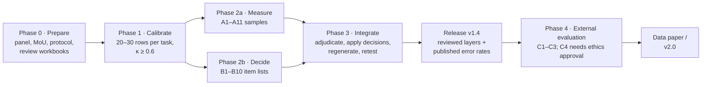

# Expert review plan

*Drafted 22 November 2026 for AyurKB v1.3.0. Current state: [STATUS_REPORT.md](STATUS_REPORT.md). Review files and how decisions flow back: [REVIEW_HANDOFF.md](REVIEW_HANDOFF.md).*

The goal is to turn AyurKB from "internally consistent, unreviewed" into a dataset whose main layers carry **measured error rates and signed expert decisions**.

Experts are not asked to check all 180,899 rows. They are asked to do two things:

1. **Measure** how accurate each layer is, using random samples that are large enough to report an error rate with a confidence interval.
2. **Decide** the specific items that the pipeline has already isolated as needing a human: quarantined links, ambiguous matches, safety records and licences.

The pass thresholds below are proposals for the maintainer and the review lead to confirm before work starts. They are not fixed standards.

## 1. The review panel

| Role | Qualification to look for | Reviews | Number |
|---|---|---|---|
| **Review lead** | MD/PhD (Ayurveda), research experience | Signs off the protocol, adjudicates disagreements, signs the final report | 1 |
| **Clinical Ayurveda reviewers** | BAMS + MD (Kāyacikitsā, Roga Nidāna or Samhitā), 5+ years of practice or teaching | Disorders, symptoms, herb → disorder links, doṣa, case-report links, Q&A | 2 |
| **Dravyaguṇa specialist** | MD/PhD (Dravyaguṇa) | Herb identity, rasa / guṇa / vīrya / vipāka / karma, herb groups, chemistry name transfers | 1–2 |
| **Safety reviewer** | Pharmacologist or Ayurveda pharmacovigilance specialist; one MBBS/MD pharmacology reviewer is a strong addition | Herb and formulation safety, hazards, scope (species, part, preparation, population) | 1–2 |
| **Hindi and Sanskrit linguists** | Postgraduate Hindi; ideally an Ayurveda-trained bilingual reviewer | Hindi translations, Sanskrit transliteration, the pending stage 02b spellings | 2 |
| **Rights adviser** | IP or licensing lawyer, or a university research-office officer | Licence terms and permissions for the 14 sources | 1 |
| **Methods adviser** (optional) | Biostatistician or clinical epidemiologist | Sampling, agreement statistics, the external evaluation design | 1 |

Each layer needs two independent reviewers, so a reviewer can't adjudicate their own disagreements.

## 2. Finding and engaging experts

**Where to look.** Postgraduate Ayurveda departments and national institutes, for example:

- the All India Institute of Ayurveda (New Delhi);
- the National Institute of Ayurveda (Jaipur);
- the Institute of Teaching and Research in Ayurveda (Jamnagar);
- the CCRAS research institutes;
- state government Ayurveda colleges with MD programmes.

The Ayurveda pharmacovigilance network, and pharmacology departments at medical colleges, are good places to find safety reviewers. Co-authorship is often the strongest incentive for academic reviewers. Section 9 lists specific institutes, official contacts and groups that have done this kind of work before.

**What to send in a first contact** (one page plus attachments):

1. What AyurKB is, in two sentences, with a link to the repository and [STATUS_REPORT.md](STATUS_REPORT.md).
2. The specific task, its sample size and an honest estimate of the time (section 5).
3. Credit: co-authorship on the data paper, or a named acknowledgement, plus any honorarium. Decide this before contacting anyone.
4. Data-handling terms: AyurKB contains no patient data, so phases 1–3 need no ethics approval. Phase 4 does (see below).

**Before anyone starts:**

- **Written agreement.** A short memorandum of understanding (MoU) or reviewer agreement covering the scope, the time, the credit, that decisions are released under the dataset's licence (CC BY-NC-SA 4.0), and that reviewers may be named.
- **Conflicts of interest.** A declaration, especially for anyone with ties to commercial herbal products.
- **Qualifications on file.** A CV or registration (for example, State Board / NCISM registration). `REVIEW_HANDOFF.md` notes that a reviewer ID records *who* decided, not their qualifications; keep that evidence separately.
- **Ethics.** Reviewing published terminology and literature doesn't involve human participants. **Phase 4**, external clinical evaluation, involves patient records and needs approval from an Institutional Ethics Committee under the ICMR national ethical guidelines before any data is collected.

## 3. Rules that apply to every review task

1. **Blind, independent double review.** Two reviewers score the same rows without seeing each other's answers or the AI pre-review. Show the AI recommendation only after both have answered, or not at all, so it can't anchor them.
2. **A calibration round first.** Both reviewers score the same 20–30 rows, discuss the differences with the lead, and the guidelines are tightened. Calibration rows don't count towards the error rate.
3. **Measure agreement.** Report Cohen's κ, or Gwet's AC1 when one answer dominates, for every task. Proposed bar: **κ ≥ 0.60**. Below that, the guideline is unclear: revise it and rerun calibration before going on.
4. **Adjudication.** The review lead decides disagreements. Keep both original answers and the final one.
5. **Every verdict has a source.** A classical text with its chapter and verse, a pharmacopoeia monograph, or a publication with its DOI. "Personal clinical experience" is recorded, but as a separate evidence type.
6. **Fixed answer vocabularies.** Use `correct`, `incorrect`, `partially correct`, `cannot judge`. Add a corrected value only when the reviewer is confident.
7. **Random samples use a fixed seed** and are drawn by script, so anyone can reproduce them.
8. **Report error rates with 95% confidence intervals** (Wilson score), not as bare percentages.

## 4. The tests

Sample sizes are set so that an error rate can be estimated to **±5 percentage points at 95% confidence**, with a finite-population correction. The ±7-point size, for a faster first pass, is given in brackets.

### A. Measure accuracy (random samples)

| # | Layer | Sample | Reviewer | What they judge | Metric | Proposed pass |
|---|---|---|---|---|---|---|
| A1 | **Active herb → disorder links** (1,044) | 282 (166) | Clinical ×2 | Does the classical source support this herb for this disorder? Is the disorder the right sense? | Precision | ≥ 90% |
| A2 | **Herb classical properties** (344 herbs) | 182 (126) | Dravyaguṇa ×2 | Each of rasa, guṇa, vīrya, vipāka and karma: correct or not, against a cited text | Per-field accuracy | ≥ 90% per field |
| A3 | **Herb identity** (453 GBIF-linked) | All 11 unresolved, plus a 60-row sample | Dravyaguṇa | Is the botanical name right for the classical drug? Is it a synonym or a substitute? | Accuracy | ≥ 95% |
| A4 | **NAMASTE disorder → symptom links** (11,883) | 373 (193). Start with the existing 151-row sample | Clinical ×2 | Is this a real symptom of this disorder in the source? Is the symptom phrase complete (not a fragment)? | Precision; fragment rate | ≥ 90%; fragments ≤ 5% |
| A5 | **Symptom recall** | 60 disorder definitions | Clinical ×2 | List every symptom in the source text, then compare with what the dataset extracted | Recall | ≥ 85% |
| A6 | **WHO and inferred symptom links** (13,639 and 10,082) | 374 and 371 | Clinical ×2 | As A4. Inferred links are expected to be weaker; the result decides whether they ship as default | Precision | Report only |
| A7 | **Doṣa suggestions** (1,420) | 303 (173) | Clinical ×2 | Is the suggested doṣa involvement right? (959 of 1,420 say vāta, so check for bias) | Accuracy; per-doṣa confusion | ≥ 80% |
| A8 | **Hindi translations** | The existing 598-field sample, plus 200 from the flagged queue | Linguists ×2 | Score **meaning** (adequacy, 1–5) and **fluency** (1–5) separately; mark term errors | Share scoring ≥ 4 on meaning | ≥ 85% unflagged; report flagged separately |
| A9 | **Sanskrit transliteration** | 200 terms | Linguist (Sanskrit) | Is the IAST and Devanāgarī spelling correct? | Accuracy | ≥ 98% |
| A10 | **Case-report links** (867) | 267 (161) | Clinical | Does the article actually report this diagnosis, herb or formulation? | Precision | ≥ 90% |
| A11 | **Q&A pairs** (4,790) | 356 (189), English and Hindi together | Clinical + linguist | Is the answer correct, safe and supported by the dataset? | Accuracy; unsafe-answer count | ≥ 95%; **0 unsafe** |

### B. Decide specific items (complete lists)

| # | Item | Size | Reviewer | Decision | File |
|---|---|---|---|---|---|
| B1 | **Herb safety** | 466 herbs; start with the 24 `review_pending` and those used in formulations | Safety ×2 | Assessment state, hazard, evidence, and scope (species, part, preparation, population, dose). Never just "safe" | [safety_review_batch.csv](../../reports/review_handoff/safety_review_batch.csv) → `curation/herb_safety_reviews.csv` |
| B2 | **Formulation safety** | 43 | Safety | As B1, including heavy-metal (rasa-śāstra) preparations | [formulation_safety_batch.csv](../../reports/review_handoff/formulation_safety_batch.csv) |
| B3 | **Candidate and quarantined links** | 39 groups (339 rows) + 49 quarantined | Clinical ×2 | Accept, reject or replace each alias. Accepted aliases go into the ledger with reviewer and reference | [candidate_groups.csv](../../reports/indication_review/candidate_groups.csv) → `curation/indication_aliases.csv` |
| B4 | **Unmatched indication terms** | 79 terms (261 rows) | Clinical | Map to a disorder, mark as no NAMASTE equivalent, or leave out | [unmatched_indication_terms.csv](../../reports/review_handoff/unmatched_indication_terms.csv) |
| B5 | **Symptom-splitting change** | 211 disorders | Clinical ×2 | For each disorder: keep the current split or accept the new one. **This unblocks the stage 02b regeneration** | [symptom_extraction_changes.csv](../../reports/revision_audit/symptom_extraction_changes.csv) |
| B6 | **Stage 02b spellings** | 104 SAT definitions + 61 mahākaṣāya names | Sanskrit linguist + Dravyaguṇa | Is the restored spelling right (for example guḍūcī, punarnavā)? Flag doubtful cases such as bādhanam → bṛṃhaṇam | [REBUILD_CHECK.md](../history/v1.3.0-revision/REBUILD_CHECK.md) |
| B7 | **Definition candidates** | 56 candidates for 37 undefined disorders | Clinical | Same sense? Can this source be used for the definition? | [alternative_definition_candidates.csv](../../reports/revision_audit/alternative_definition_candidates.csv) |
| B8 | **Herb-property and chemistry drafts** | 26 herbs with leads; 6 chemistry name transfers | Dravyaguṇa | Approve or reject each property with its citation; decide each species-identity transfer | [REVIEW_HANDOFF.md](REVIEW_HANDOFF.md) items 16 and 19 |
| B9 | **Link gaps** | 254 rows | Dravyaguṇa | Is this a legitimate non-link or an unresolved identity? | [link_gap_triage.csv](../../reports/review_handoff/link_gap_triage.csv) |
| B10 | **Source rights** | 14 sources | Rights adviser | Exact licence terms or permission granted, permitted scope, and what must be removed | [rights_review_batch.csv](../../reports/review_handoff/rights_review_batch.csv), `docs/review/permission_requests/` |

### C. Independent (external) evaluation

| # | Test | What is needed | Notes |
|---|---|---|---|
| C1 | **External case-report test set** | Two clinicians independently label diagnoses and symptoms for an eligible subset of the 736 collected publications. The model is then run once on the frozen set | Gives the first external accuracy figure. Follow [EVALUATION_PROTOCOL.md](EVALUATION_PROTOCOL.md) |
| C2 | **Independent search queries** | Clinicians write realistic queries without seeing the dataset; the queries are then run against the search index | Fills [independent_query_template.csv](../../curation/independent_query_template.csv). Measures real retrieval quality |
| C3 | **Study appraisal** | A methods adviser grades the "clinical evidence" studies (design, size, risk of bias) | Fills [study_appraisal_template.csv](../../curation/study_appraisal_template.csv). Turns search counts into evidence grades |
| C4 | **Prospective clinical evaluation** (optional, later) | Patient data from a clinic under ethics approval | **Needs Institutional Ethics Committee approval** and a registered protocol. Only if the dataset is to support clinical decision tools |

## 5. Rough effort

These are planning estimates, assuming 1–2 minutes per simple row, 5–10 minutes per safety record or adjudication, and two reviewers per task.

| Block | Reviewer-days (two reviewers combined) |
|---|---|
| Calibration rounds (all tasks) | 3–4 |
| A1–A7, A10 clinical and Dravyaguṇa samples | 18–25 |
| A8–A9 language samples | 6–8 |
| A11 Q&A | 3–4 |
| B1–B2 safety | 12–18 |
| B3–B9 decisions | 10–14 |
| B10 rights | 2–4 (adviser) |
| C1–C3 external evaluation | 15–25 |
| **Total** | **about 70–100 reviewer-days**, or 3–5 months part-time for a panel of 6–8 people |

Using the ±7-point samples for the first pass cuts the A block by about 40%.

## 6. High-level map

| Phase | Weeks | Output | Exit check |
|---|---|---|---|
| **0. Prepare** | 1–3 | Panel recruited, agreements signed, protocol and guidelines signed by the lead, sample files drawn with a fixed seed, review desk set up | Every reviewer has signed and has their files |
| **1. Calibrate** | 4–5 | Revised guidelines for each task | κ ≥ 0.60 on each task |
| **2a. Measure** | 6–14 | Scored samples with both reviewers' answers | All sample rows scored by two reviewers |
| **2b. Decide** | 6–14, in parallel | Safety, alias, rights and spelling decisions | Every listed item has a signed decision |
| **3. Integrate** | 15–17 | Decisions merged through the existing curation files, symptom review applied, stage 02b regenerated, tests rerun, error rates written into the datasheet | Tests pass; every layer's error rate and CI is published |
| **Release v1.4** | 18 | First expert-reviewed release | Release notes list what was reviewed, by whom, and what was not |
| **4. External evaluation** | 18+ | External test set, independent queries, study grades; clinical study only with ethics approval | Results in a protocol-locked report |

**Suggested priority if time or budget is short:** B1–B2 (safety) → A1 + B3 (herb links) → B5 + B6 (unblocks the rebuild) → A2 (herb properties) → A8 (Hindi) → everything else. Safety comes first because it is the only area where a wrong record can cause harm.

## 7. What engineering does with the results

1. Validate the returned files: IDs exist, vocabularies are respected, every verdict has a reviewer and a reference.
2. Compute agreement and error rates with confidence intervals, by script, and publish them under `reports/expert_review/`.
3. Apply decisions only through the curation files (`indication_aliases.csv`, `herb_safety_reviews.csv`, `mt_*_corrections.csv`, `source_rights_review.csv`). Never hand-edit the processed tables.
4. Apply the symptom-splitting decisions (B5), regenerate from stage 02b, review the diff, and rerun the full test suite.
5. Change review states from `unreviewed` to `expert_reviewed` only for rows with a signed decision, and keep the rest labelled honestly.
6. Update the datasheet, the README and the release notes with what was reviewed, by whom (with consent), and the measured error rates.

## 8. Checklist for the first meeting with an expert

- [ ] [STATUS_REPORT.md](STATUS_REPORT.md), printed or as a PDF
- [ ] This plan, with the thresholds marked "proposed, for your input"
- [ ] A short live demo: the review desk (`release/tools/review_desk.html`) and a few example records
- [ ] 10 sample rows from their area, to show exactly what they'd judge
- [ ] A time estimate for their part, and the credit offered
- [ ] A draft reviewer agreement and conflict-of-interest form
- [ ] Questions for them: Which classical references should be the standard? Are the thresholds reasonable? Who else should be on the panel?

## 9. Who to approach

*Contacts checked on 22 November 2026 against each organisation's own website or the paper itself. Office holders change, so check the linked page before writing. For individual researchers, write to the corresponding author named in the paper, or through their institute's page. Don't use personal addresses found elsewhere.*

### 9.1 National institutes (clinical, Dravyaguṇa and safety reviewers)

| Organisation | Why them | Official contact | Fits |
|---|---|---|---|
| **Central Council for Research in Ayurvedic Sciences (CCRAS)**, Ministry of Ayush, New Delhi | Built and maintains the **NAMASTE** terminology that AyurKB's disorders and SAT terms come from; also runs a network of peripheral research institutes | Director General: `dg-ccras@nic.in`, 011-28524457 · [contact page](https://ccras.nic.in/contact/) · [peripheral institutes](https://ccras.nic.in/institutes-contact-details-new/) | B5, B6, B7, A4–A6; source questions on NAMASTE (B10) |
| **All India Institute of Ayurveda (AIIA)**, New Delhi | Postgraduate departments in every specialty; hosts the national pharmacovigilance centre (next row) | `contact-us@aiia.gov.in`, 011-26950401/402 · [aiia.gov.in](https://aiia.gov.in/) | Review lead, A1–A7, A11 |
| **National Pharmacovigilance Coordination Centre (NPvCC)** for Ayurveda, Siddha, Unani and Homoeopathy drugs, at AIIA | Runs **Ayush Suraksha**, the national database of adverse reactions to Ayush drugs | `ayush-pharmavig@aiia.gov.in` · [suraksha.ayush.gov.in](https://suraksha.ayush.gov.in/) · [contact](https://www.ayushsuraksha.com/contact/) | **B1, B2 (safety)** |
| **National Institute of Ayurveda (NIA)**, Jaipur (deemed university) | Large postgraduate faculty in Kāyacikitsā, Dravyaguṇa and Samhitā | `nia-rj@nic.in`, 0141-2635816 · [contact page](https://nia.edu.in/page.php?id=88) | A1–A7, A2, B3, B4 |
| **Institute of Teaching and Research in Ayurveda (ITRA)**, Jamnagar | Long-standing postgraduate and research institute; early home of the Ayurveda pharmacovigilance programme | `director@itra.edu.in`, 0288-2552014 · [contact page](https://itra.ac.in/contact/) | A1–A7, B1, B6 |
| **The University of Trans-Disciplinary Health Sciences and Technology (TDU)** and **FRLHT**, Bengaluru | Built the **Indian Medicinal Plants Database** (7,263 botanical names, linked to their Ayurvedic identity), and runs a plant identification and substitution service | `info@tdu.edu.in`, 080-2856 8000 · [plant database](https://www.tdu.edu.in/outreach/indian-medicinal-plants-database) · [identification service](https://www.tdu.edu.in/outreach/medicinal-plant-identification-substitution) · FRLHT: `info@frlht.org` | **A3, B8, B9 (herb identity)**, A2 |
| **WHO Global Traditional Medicine Centre (GTMC)**, Jamnagar | WHO department for traditional medicine, the home of the **WHO ITA 2022** terminology that AyurKB uses | No public email; use the [WHO GTMC pages](https://www.who.int/teams/who-global-traditional-medicine-centre/overview) | B10 (WHO licence terms); a possible endorsement later |

State government Ayurveda colleges with MD programmes, and the Ayurveda faculties of universities such as Banaras Hindu University, are also good sources of reviewers. Find their department pages through the National Commission for Indian System of Medicine (NCISM).

### 9.2 Groups that have built similar resources

These groups have already done this kind of work, so they know the problems and some may want to collaborate or co-author.

| Group | What they built | Contact route | Fits |
|---|---|---|---|
| **Saketh Ram Thrigulla** (CCRAS) and **Mitali Mukerji** (Centre of Excellence "AyurTech", IIT Jodhpur) | Thrigulla is first author of the paper describing the **NAMASTE** initiative ([J Ayurveda Integr Med, 2023](https://www.sciencedirect.com/science/article/pii/S0975947623000979)). Both worked together on linking the Human Phenotype Ontology to Ayurveda's *Anukta Vyādhi* framework ([2026](https://doi.org/10.1016/j.jaim.2026.101322)) | Corresponding authors via the papers; IIT Jodhpur AyurTech | B5, B7, A4–A6: closest to AyurKB's NAMASTE layer |
| **Areejit Samal's group**, Institute of Mathematical Sciences (IMSc), Chennai | **IMPPAT**, the curated database of Indian medicinal plants, phytochemicals and uses (v2.0 in [ACS Omega, 2023](https://pubs.acs.org/doi/full/10.1021/acsomega.3c00156); v3.0 adds formulations) | Published corresponding author: `asamal@imsc.res.in` · [IMPPAT](https://cb.imsc.res.in/imppat/) | Chemistry layer, B8 name transfers, A3 |
| **Ramanathan Sowdhamini's group**, National Centre for Biological Sciences (NCBS-TIFR), Bengaluru | **GRAYU**, a graph database linking Ayurvedic formulations, plants, phytochemicals and diseases ([Front Pharmacol, 2025](https://doi.org/10.3389/fphar.2025.1727224)) | Corresponding authors via the paper · [GRAYU](https://caps.ncbs.res.in/GRAYU/) | Herb → disorder links (A1), formulations (B2) |
| **Arnab Bhattacharya and Hrishikesh Terdalkar**, IIT Kanpur | A knowledge graph of the *Bhāvaprakāśa Nighaṇṭu*, annotated by hand with Ayurveda experts ([2022](https://arxiv.org/abs/2202.00216)), and *Āyurjñānam* | Via the paper · [sanskrit.iitk.ac.in/ayurveda](https://sanskrit.iitk.ac.in/ayurveda/) | A2 (herb properties from a classical text), A9 (Sanskrit) |
| **BharatGen** (IIT Bombay-led consortium; Ganesh Ramakrishnan and colleagues) | **BhashaBench-Ayur**, 14,963 English and Hindi Ayurveda exam questions, and **AyurParam**, a bilingual Ayurveda language model ([2025](https://arxiv.org/abs/2511.02374)) | Via the paper · [bharatgen.com](https://bharatgen.com/blogs/bhashabench-ayur-evaluating-ai-ayurvedic-intelligence/) | A8, A11 (bilingual Q&A), C2 |
| **AI4Bharat**, IIT Madras | **IndicTrans2** translation models and large human evaluations of Hindi translation | Via [ai4bharat.iitm.ac.in](https://ai4bharat.iitm.ac.in/) | A8 (Hindi translation method and reviewers) |
| **Mohan Raghavan**, Bheri Technology Foundation / HTSR Institute | Ontology-guided knowledge graph and evidence retrieval for Indian Knowledge Systems texts ([2026](https://arxiv.org/abs/2611.14050)) | Via the paper | C2 (retrieval evaluation) |

### 9.3 Suggested order of approach

1. **CCRAS first.** AyurKB is built on their NAMASTE data, so they are the natural reviewers for the disorder and symptom layers and the right people for the NAMASTE licence question. Ask whether a CCRAS scientist, or the NAMASTE team, can review B5–B7 and suggest clinical reviewers.
2. **The NPvCC at AIIA for safety** (B1, B2), because safety is the highest-priority block.
3. **TDU/FRLHT for herb identity** (A3, B8, B9).
4. **One of the research groups** in 9.2 as a methods and co-authorship partner. The NAMASTE/AyurTech authors are the closest fit.
5. **NIA and ITRA** for more clinical and Dravyaguṇa reviewers, if CCRAS and AIIA can't supply enough.

Send one short email per organisation, to the official address above, with the first-contact contents from section 2 and the [status report](STATUS_REPORT.md) attached. For government institutes, a formal letter addressed to the Director or Director General is usual. Expect replies to take weeks, so contact several organisations at once.
